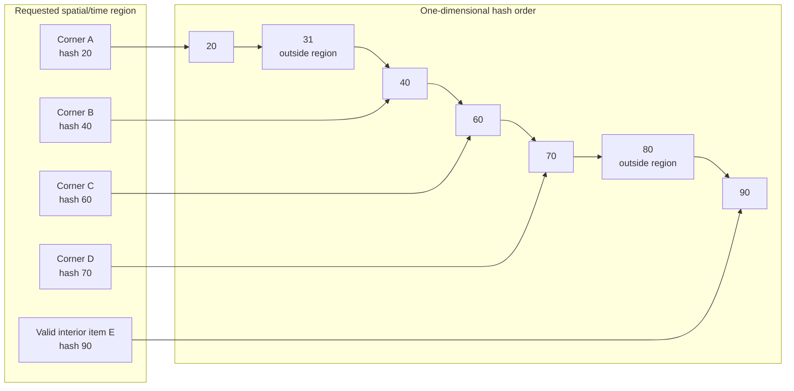
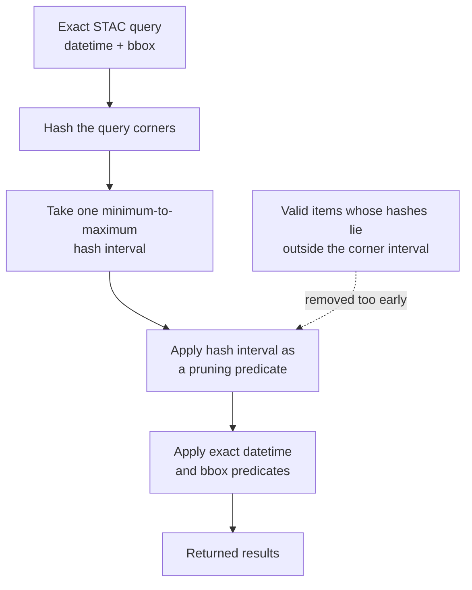

# Why a corner-derived hash range can miss valid search results

The benchmark converts a STAC search region—longitude, latitude, and time—into
one numeric hash interval. It currently hashes the corners of that region and
uses the smallest and largest corner hashes as the interval bounds.

This is not guaranteed to cover every point inside the region. A
space-filling hash turns three dimensions into a one-dimensional order, and
that order can leave and re-enter the query region many times.

## A simplified two-dimensional view

The real hash combines time, longitude, and latitude. This diagram shows a
two-dimensional slice because the same ordering problem is easier to see.



The corner hashes produce the interval `20–70`. Item E is spatially and
temporally inside the requested region, but its hash is `90`, so this filter
incorrectly removes it:

```sql
WHERE "hash:hash" BETWEEN 20 AND 70
```

The same interval can also contain hashes belonging to items outside the
region, such as hash `31`. Those false positives are harmless if the query
retains the exact datetime and bounding-box predicates. The missing item E is
a false negative, which cannot be repaired after the hash filter removes it.

## What happened in the benchmark



The full benchmark exposed the problem through result-count mismatches:

| Dataset layout | Exact STAC search | Hash-assisted search | Missing |
|---|---:|---:|---:|
| Microsoft hashed, 16 files | 783 | 768 | 15 |
| Microsoft hashed, 12 files | 783 | 768 | 15 |
| Holmes hashed, 1 file | 22 | 19 | 3 |
| Holmes hashed, 4 files | 22 | 19 | 3 |
| Holmes hashed, 8 files | 22 | 19 | 3 |

The identical missing counts across file layouts show that this is not a file
or row-group issue. It comes from the query region being represented by an
incomplete hash interval.

## What a correct pruning query needs

The search region may map to several disjoint sections of the one-dimensional
hash order:

```text
hash order  ──────────────────────────────────────────────────────────────▶

             [range 1]       [range 2]              [range 3]
             █████████       ████████               ██████████
                 ▲               ▲                       ▲
                 └──── all overlap the same 3D query region ────┘
```

A correct implementation should therefore derive a conservative set of hash
ranges that covers every possible match, and then retain the exact predicates:

```sql
WHERE (
       "hash:hash" BETWEEN :range_1_min AND :range_1_max
    OR "hash:hash" BETWEEN :range_2_min AND :range_2_max
    OR "hash:hash" BETWEEN :range_3_min AND :range_3_max
)
  AND datetime >= :start_datetime
  AND datetime < :end_datetime
  AND bbox.xmax >= :minx
  AND bbox.xmin <= :maxx
  AND bbox.ymax >= :miny
  AND bbox.ymin <= :maxy;
```

The hash ranges are a coarse pruning step; the datetime and bbox checks remain
the source of truth. A conservative range decomposition may admit extra items,
but it must never omit an item that satisfies the exact STAC search.

## The practical rule

Use the hash to skip data, not to define correctness. Before comparing speed,
the ordinary and hash-assisted searches must return identical result sets.

## Benchmark fix

The benchmark now establishes correctness by running the exact predicates during
untimed parameter setup and finding the minimum and maximum hash among the rows
that actually match. Its timed hash-assisted query uses that conservative interval
and repeats every exact collection, datetime, and bbox predicate.

This guarantees parity for the benchmark: all exact matches lie inside the chosen
interval, while any unrelated hashes between its bounds are rejected by the exact
predicates. It is deliberately not presented as a production query planner,
because discovering the interval requires the exact scan that a real hash index is
supposed to avoid. A production implementation still needs a conservative range
decomposition derived from the query region alone.

The corrected seven-dataset remote run (`20261027T011639Z`) validated the fix.
Both Microsoft layouts returned 783 rows from the ordinary and hash-assisted
queries, and all three Holmes layouts returned 22 rows from both queries. The
conservative ranges contained 9,532 Microsoft candidates and 726 Holmes
candidates, so correctness is restored but range selectivity remains limited.
